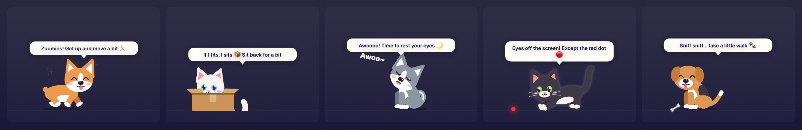

<p align="center">
  
</p>

<h1 align="center">Healthy Pops</h1>

<p align="center">
  <b>Tiny popups that keep you healthy at your Mac.</b><br>
  Eye breaks, water, posture and your own reminders, with a cat or dog to keep you company. Free forever, open source.
</p>

<p align="center">
  <a href="https://github.com/ThusharaSampath/healthy-pops/releases/latest"></a>
  
  
  <a href="LICENSE"></a>
</p>

<p align="center">
  <a href="https://github.com/ThusharaSampath/healthy-pops/releases/latest/download/HealthyPops.dmg"><b>⬇&nbsp; Download for Mac</b></a>
  &nbsp;·&nbsp;
  <a href="https://healthy-pops.pages.dev">Website</a>
</p>

<p align="center">
  
</p>

## What it does

|  |  |
|---|---|
| 👀 **Eye breaks** | The 20-20-20 rule on autopilot. A heads-up, then a calm 20-second break with nothing to read. |
| 💧 **Water** | A silly nudge every hour. Log a glass with <kbd>⌃⌥W</kbd>. |
| 🧍 **Posture** | Five seconds, one cheeky line, gone. |
| ✨ **Your own popups** | Pick a title, icon, colour and interval in a keyboard-first editor. |
| 🐾 **Break pets** | Cats and dogs take turns turning up during eye breaks to do one cute thing: nap, sit in a box, chase a laser dot, get the zoomies, howl, dig for a bone. Seven cats, eight dogs, four ways in, never the same twice in a row. |
| 🥣 **Pets on reminders** | A small pet steps out from behind your reminders and acts them out: laps from a water bowl (and cheers when you log a glass), sits up tall for posture, waves for your own popups. |

<p align="center">
  
</p>

Every popup counts **real screen time** (lock, sleep or walk away and it starts over), **waits while you're in a call**, and can be tuned or switched off from the menu bar. Pick **Cats & Dogs**, **Cats**, **Dogs** or **Off** under **Break Pet**. No account, no network, no permissions. Native Swift, under 1 MB.

## Install

1. [Download `HealthyPops.dmg`](https://github.com/ThusharaSampath/healthy-pops/releases/latest/download/HealthyPops.dmg) and drag the app to Applications.
2. First launch only: right-click the app → **Open** (it isn't notarized yet).
3. It lives in your menu bar. Turn on **Launch at Login** there.

## Build from source

```bash
git clone https://github.com/ThusharaSampath/healthy-pops
cd healthy-pops
./build.sh --install
```

Needs Swift 5.9+ (Xcode or Command Line Tools). Run with `HEALTHYPOPS_DEBUG=1` for a 30-second cycle while testing.

## Contributing

PRs are very welcome: funnier messages (`Sources/HealthyPops/NudgeToast.swift`), new built-in popups, new pet activities (`Sources/HealthyPops/PetShow.swift`) or coats and breeds (`Sources/HealthyPops/PetFigure.swift`), fixes and ideas. Pushing a `v*` tag builds a universal DMG, publishes the release and deploys the website.

## License

[MIT](LICENSE) © Thushara Sampath
